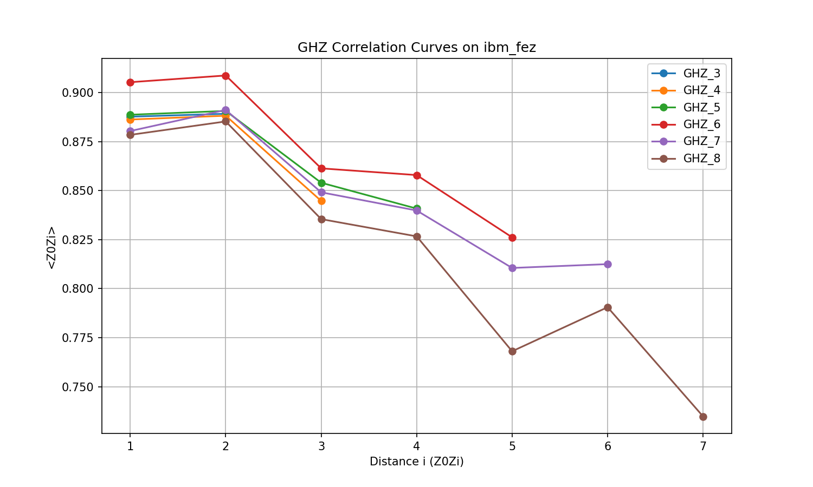

# 0_quantum

Hands-on experiments with quantum computing, run on IBM's real quantum processors
through the free IBM Quantum Platform plan, using Qiskit (IBM's Python library for
quantum programs). This was a curiosity-driven project from late 2025 to early 2026: I
wanted to see what today's quantum hardware actually does, as opposed to what the
textbook says it should do.

## What's here

| Folder | What it is |
|---|---|
| `bell_state/` | The first real-hardware run: a two-qubit entangled pair (a Bell state) on `ibm_torino`, a script to fetch and plot a finished job later by its ID, and a write-up of how Qiskit translated the simple circuit into the processor's native gates. |
| `EMBP/` | **Error-Mitigated Bell State Project.** The same Bell state, but with readout correction: first measure how often the hardware misreports known states (a calibration "confusion matrix"), then use that to correct the experiment's results. Includes notes on the confusion matrix and on how qubit calibration drifts over minutes to days. |
| `GHZ_state_decay/` | **How far does entanglement reach?** Builds GHZ states (all N qubits linked together) for N = 3 to 8 on `ibm_fez`, and measures how strongly the first qubit's result still matches each of the others. Results in CSV, plots, and a write-up. |
| `qiskit/` | Early warm-up circuits on the local simulator: single-qubit gates, Bloch sphere plots, a circuit with a deliberately restricted "noisy" qubit. |
| `docs/` | Background notes: a quantum teleportation circuit, why relative phase matters, and an overview of IBM's processor generations. |
| `ibm_backend_diagnostic.py` | A read-only health check for an IBM processor: status, queue, calibration age, per-qubit error rates. |
| `verify_api*.py` | Checks that the IBM connection and API key work. |

## The main result

In a perfect machine every correlation in the GHZ experiment would be 1.0. On
`ibm_fez` (January 2026) they started around 0.89 for neighbouring qubits and fell
off with distance and with size: in the 8-qubit state, the first and last qubits agreed
only about 0.73 of the time.

That fall-off is the practical face of the current "NISQ" era (noisy, intermediate-scale
quantum): every added qubit and gate adds noise, and the useful signal fades well before
the hardware runs out of qubits. It's also why I set the project aside for now. At this
stage progress depends mostly on the hardware, not on what an outside experimenter can
contribute.

## How it was made

The experiments, runs and results are mine. The code and the explanatory PDFs were
written with ChatGPT, which I used as a tutor and pair programmer;
the comments in the scripts are deliberately long for that reason.

## Running the scripts

Needs Python 3 with `qiskit`, `qiskit-ibm-runtime`, `qiskit-aer` and `matplotlib`, and
a free IBM Quantum Platform account. The scripts read the API key from a local file,
`.ibm_api` (the key alone) or `ibm_apikey.json` (`{"apikey": "..."}`). Both names are
in `.gitignore`; never commit them.
